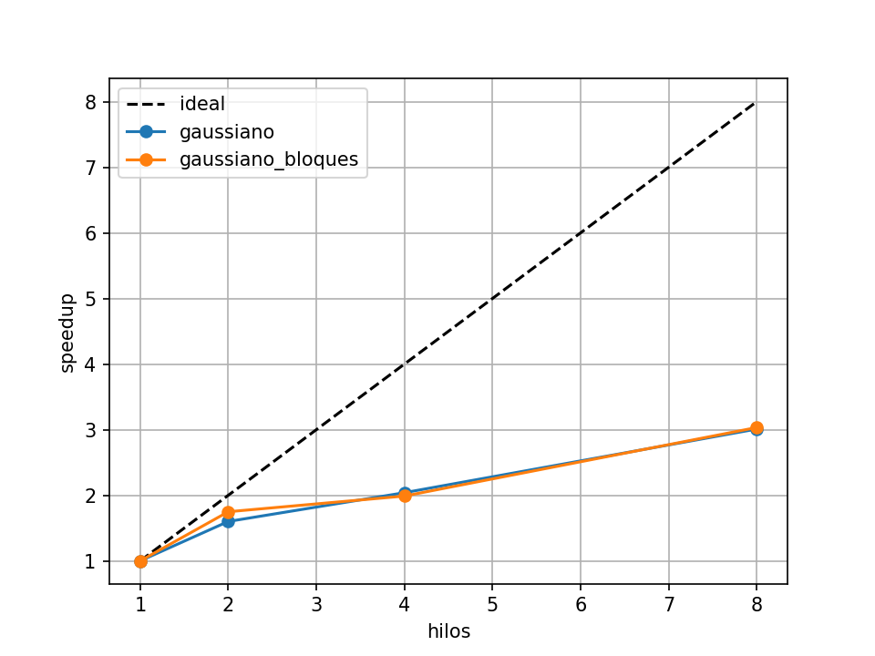

# 02. Motor: filtros, paralelización y mediciones

## Máquina de medición

| Campo | Valor |
|---|---|
| Procesador | AMD Ryzen 5 3400G (4 núcleos físicos, 8 hilos lógicos, SMT) |
| Caché | L1d 32 KiB y L2 512 KiB por núcleo, L3 4 MiB compartida |
| Memoria | 3.8 GiB asignados a WSL2; swap de 1 GiB sin uso durante las mediciones |
| Sistema | Ubuntu sobre WSL2 (hipervisor de Microsoft) |
| Compilador | g++ 15.2.0, `-std=c++17 -O2 -Wall -Wextra -fopenmp` |

Todas las mediciones de este documento salen de esta misma máquina, con el portátil conectado a la corriente y sin programas pesados abiertos.

## Gaussiano separable

Se implementa en dos pasadas. La horizontal aplica el núcleo binomial `[1 4 6 4 1]/16` sobre la imagen de entrada y guarda el resultado intermedio `T` en `double`, sin redondear. La vertical aplica el mismo núcleo sobre `T` y redondea solo al final, con empates hacia arriba y saturación a [0, 255]. Los bordes se resuelven por repetición del píxel más cercano.

Se entregan tres versiones con la misma aritmética:

- **Secuencial** (`gaussiano_secuencial`): referencia de corrección y de tiempo T(1) del algoritmo original.
- **Paralela** (`gaussiano_paralelo`): cada pasada es un `#pragma omp parallel for schedule(static)` sobre filas. La primera pasada escribe `T` dentro de la región paralela, así que la puesta a cero y la primera escritura se reparten entre hilos. El fin del primer `parallel for` actúa como barrera antes de la segunda pasada.
- **Por bloques** (`gaussiano_bloques`): cada bloque de 16 filas de salida calcula en un buffer privado de cada hilo solo las filas de `T` que necesita (16 más 4 de vecindad), y aplica la pasada vertical sobre ese buffer. No se guarda `T` completo.

**Justificación del reparto por filas.** La imagen se almacena por filas, así que una banda de filas es un bloque contiguo en memoria. Repartir por filas da a cada hilo una zona de memoria continua y evita que dos hilos escriban en líneas de caché vecinas al repartir columnas.

**Política de planificación.** `schedule(static)`: las filas tienen el mismo costo, así que un reparto fijo basta y no añade gasto de planificación dinámica.

## Corrección

Salida de `make clean && make pruebas`, con la versión final del motor:

```
g++ -std=c++17 -O2 -Wall -Wextra -fopenmp -Isrc -o motor src/main.cpp src/filtros.cpp src/imagen.cpp
g++ -std=c++17 -O2 -Wall -Wextra -fopenmp -Isrc -o comparar tests/comparar.cpp
g++ -std=c++17 -O2 -Wall -Wextra -fopenmp -Isrc -o generar bench/generar.cpp src/imagen.cpp
g++ -std=c++17 -O2 -Wall -Wextra -fopenmp -Isrc -o arnes bench/arnes.cpp src/filtros.cpp src/imagen.cpp
g++ -std=c++17 -O2 -Wall -Wextra -fopenmp -Isrc -o test_gaussiano tests/test_gaussiano.cpp src/filtros.cpp src/imagen.cpp
bash tests/pruebas.sh
Salida esperada, calculada aparte:
  ok    gris sobre la imagen de prueba
  ok    caja sobre la imagen de prueba
Lectura y escritura:
  ok    gris rechaza una imagen de un canal
  ok    caja sobre un canal escribe P5
Paralelo contra secuencial, imagen de 512x512:
  ok    gris idéntico con 1 hilo(s)
  ok    gris idéntico con 8 hilo(s)
  ok    caja idéntico con 1 hilo(s)
  ok    caja idéntico con 8 hilo(s)
  ok    gaussiano idéntico con 1 hilo(s)
  ok    gaussiano idéntico con 8 hilo(s)
Gaussiano separable contra forma directa 5x5:
  ok    gaussiano separable contra forma directa
Filtro desconocido:
  ok    la cadena con un filtro inexistente se rechaza
Cadenas que no se pueden aplicar:
  ok    sobel se rechaza antes de aplicar nada
  ok    gris,gris se rechaza antes de aplicar nada
  ok    otsu se rechaza antes de aplicar nada

todas las pruebas pasaron
```

La compilación no produce avisos con `-Wall -Wextra`.

Comparación del gaussiano con la forma directa 5x5 y con la versión por bloques (`./test_gaussiano`):

```
Gaussiano separable contra forma directa 5x5, imágenes aleatorias:
  ok    gaussiano 1x1 con 1 canal(es), secuencial
  ok    gaussiano 1x1 con 1 canal(es), paralelo
  ok    gaussiano 1x1 con 1 canal(es), bloques
  ok    gaussiano 2x3 con 1 canal(es), secuencial
  ok    gaussiano 2x3 con 1 canal(es), paralelo
  ok    gaussiano 2x3 con 1 canal(es), bloques
  ok    gaussiano 7x5 con 1 canal(es), secuencial
  ok    gaussiano 7x5 con 1 canal(es), paralelo
  ok    gaussiano 7x5 con 1 canal(es), bloques
  ok    gaussiano 37x23 con 1 canal(es), secuencial
  ok    gaussiano 37x23 con 1 canal(es), paralelo
  ok    gaussiano 37x23 con 1 canal(es), bloques
  ok    gaussiano 16x9 con 3 canal(es), secuencial
  ok    gaussiano 16x9 con 3 canal(es), paralelo
  ok    gaussiano 16x9 con 3 canal(es), bloques
  ok    gaussiano 64x48 con 3 canal(es), secuencial
  ok    gaussiano 64x48 con 3 canal(es), paralelo
  ok    gaussiano 64x48 con 3 canal(es), bloques
Gaussiano separable contra forma directa 5x5, imagen de prueba:
  ok    gris.pgm, secuencial
  ok    gris.pgm, paralelo
  ok    gris.pgm, bloques
gaussiano: todas las pruebas pasaron
```

La comparación paralela contra secuencial se hace byte a byte con 1 y 8 hilos, mediante `comparar`, dentro de `pruebas.sh`.

## Tiempos y escalado

Imagen de medición: 4096 × 4096 en color, generada con `generar`. Se miden cinco repeticiones por configuración con `bench/medir.sh`. Se descarta la primera y se reporta la mediana de las cuatro restantes. El tiempo es de pared alrededor del filtro, sin lectura ni escritura del archivo.

**Referencia secuencial original** (`arnes gaussiano ... --secuencial`): T(1) = 1012.54 ms, con dispersión entre 980 y 1194 ms.

### Versión paralela

| p | T(p) ms | S(p) = T(1)/T(p) | E(p) = S(p)/p |
|---|---|---|---|
| 1 | 967.12 | 1.00 | 1.00 |
| 2 | 604.10 | 1.60 | 0.80 |
| 4 | 474.18 | 2.04 | 0.51 |
| 8 | 321.36 | 3.01 | 0.38 |

### Versión por bloques

| p | T(p) ms | S(p) = T(1)/T(p) | E(p) = S(p)/p | Mínimo–máximo (ms) |
|---|---|---|---|---|
| 1 | 554.67 | 1.00 | 1.00 | 540.02–661.23 |
| 2 | 317.11 | 1.75 | 0.87 | 307.87–394.32 |
| 4 | 278.97 | 1.99 | 0.50 | 270.23–281.08 |
| 8 | 182.87 | 3.03 | 0.38 | 179.01–188.52 |

### Comparación contra la referencia secuencial

| p | Paralela T(p) ms | Por bloques T(p) ms | Por bloques frente a secuencial original | Por bloques frente a la paralela |
|---|---|---|---|---|
| 1 | 967.12 | 554.67 | 1.83 | 1.74 |
| 2 | 604.10 | 317.11 | 3.19 | 1.90 |
| 4 | 474.18 | 278.97 | 3.63 | 1.70 |
| 8 | 321.36 | 182.87 | 5.54 | 1.76 |

La columna de la versión por bloques frente a la secuencial original mezcla dos efectos: la mejora de localidad, que ya aparece con un hilo, y el paralelismo. Por eso la superlinealidad aparente con 2 hilos (eficiencia 1.60 frente a la referencia) no es escalado real. El escalado propio de la versión por bloques es la columna S(p) de la tabla anterior.

### Gráfica de speedup



La gráfica muestra las dos versiones del gaussiano, cada una con su propio T(1), y la recta ideal. Las curvas de los demás filtros y de la cadena completa no están medidas en este documento todavía.

## Perfilado

Herramientas: `/usr/bin/time -v` para memoria y fallos de página, y `perf stat` para tiempo y fallos de página. Los contadores de hardware no están disponibles en WSL2: `cpu-cycles` aparece como no soportado, así que no se puede medir la tasa de fallos de caché.

| Medición | Paralela | Por bloques |
|---|---|---|
| Memoria residente máxima, 1 hilo | 495 704 KiB | 117 888 KiB |
| Fallos de página menores, 1 hilo | 123 054 | 28 608 |
| Fallos de página, 4 hilos, 5 llamadas | 565 413 | 76 744 |
| Tiempo de usuario, 4 hilos, 5 llamadas | 6.81 s | 4.95 s |
| Tiempo de sistema, 4 hilos, 5 llamadas | 1.61 s | 0.24 s |

Conclusión del perfilado. La versión paralela necesita unos 480 MiB por llamada, de los cuales 384 MiB corresponden al intermedio `T` en color (4096 × 4096 × 3 × 8 bytes). Una parte importante del tiempo de sistema se debe a asignar y tocar esas páginas. Al pasar a la versión por bloques, la memoria máxima baja a unos 118 MiB, los fallos de página se reducen cerca de siete veces con 4 hilos y el tiempo de sistema baja de 1.61 s a 0.24 s. Esas reducciones son mediciones directas. La explicación de caché (que el buffer por bloque cabe en L2 y se reutiliza) es la interpretación más probable, pero no se comprobó con contadores de hardware.

## Optimización de localidad

**Elección del filtro.** El gaussiano es el filtro que peor escala: su eficiencia cae de 0.80 a 0.38 entre 2 y 8 hilos, y su intermedio `T` ocupa 384 MiB frente a una caché L3 de 4 MiB. Por eso se eligió para la optimización.

**Qué cambió en el acceso a memoria.** La versión paralela recorre la imagen completa en la primera pasada, escribe `T` completo y luego lo vuelve a leer en la segunda. La versión por bloques recorre la imagen en bloques de 16 filas: calcula en un buffer privado de cada hilo las filas de `T` que necesita, y aplica la pasada vertical sobre ese buffer antes de pasar al siguiente bloque. Así `T` nunca ocupa su tamaño completo, las filas se reutilizan mientras siguen en caché y se reduce el tráfico de memoria. El costo es recalcular 4 filas de vecindad por bloque, que se paga a cambio de no tocar 384 MiB de memoria.

**Medición antes y después.** Con el mismo arnés y las mismas cinco repeticiones:

| p | Paralela T(p) ms | Por bloques T(p) ms | Mejora |
|---|---|---|---|
| 1 | 967.12 | 554.67 | 1.74× |
| 2 | 604.10 | 317.11 | 1.90× |
| 4 | 474.18 | 278.97 | 1.70× |
| 8 | 321.36 | 182.87 | 1.76× |

La mejora es consistente en todos los números de hilos, incluido el de un hilo, donde no hay paralelismo y la diferencia viene solo del acceso a memoria.

**Salida idéntica.** La versión por bloques cumple las pruebas de `test_gaussiano` y de `pruebas.sh`, que comparan la salida byte a byte con la secuencial. Como la aritmética y el orden de suma son los mismos, no cambia el resultado.

## Evidencia de salida paralela idéntica

La evidencia está en las secciones de Corrección: `pruebas.sh` compara byte a byte la salida paralela con la secuencial para `gris`, `caja` y `gaussiano`, con 1 y 8 hilos, y `test_gaussiano` compara las tres versiones del gaussiano contra la forma directa 5x5.

# Motor de procesamiento de imágenes: Sobel, histogramas, ecualización y Otsu

## 1. Introducción

Este documento describe la implementación, paralelización, validación y evaluación de rendimiento de los componentes de procesamiento de imágenes desarrollados para el motor del proyecto.

El trabajo comprende cuatro componentes principales:

- **Sobel:** cálculo de la magnitud del gradiente para la detección de bordes.
- **Histograma:** cálculo de la distribución de intensidades de una imagen en escala de grises.
- **Ecualización:** transformación del contraste mediante el histograma acumulado.
- **Otsu:** cálculo automático de un umbral para la binarización de imágenes.

Se implementaron versiones secuenciales y paralelas de los algoritmos, buscando mantener la equivalencia de sus resultados y aprovechar la ejecución multihilo mediante OpenMP.

También se realizaron experimentos para estudiar la contención de operaciones atómicas, el efecto del false sharing y la influencia de la parte secuencial del algoritmo Otsu mediante la ley de Amdahl.

## 2. Entorno de pruebas

Las mediciones se realizaron bajo las siguientes condiciones:

| Característica | Configuración |
|---|---|
| Sistema operativo | Debian GNU/Linux |
| Compilador | g++ |
| Estándar de C++ | C++17 |
| Optimización | -O2 |
| Paralelismo | OpenMP |
| Advertencias | -Wall -Wextra |
| Procesador | Intel Core i3-1005G1 |
| Núcleos físicos | 2 |
| Procesadores lógicos | 4 |
| Tamaño de imagen | 4096 × 4096 píxeles |
| Repeticiones | 5 |
| Repeticiones descartadas | Primera |
| Medida estadística | Mediana de las cuatro restantes |
| Cantidad de hilos | 1, 2, 4 y 8 |

Las imágenes utilizadas para las mediciones principales fueron de un canal, correspondientes al formato PGM.

El tiempo de lectura y escritura de archivos se excluyó de las mediciones. El cronómetro rodeó únicamente la ejecución del algoritmo evaluado.

### 2.1. Metodología de medición

Para cada configuración se realizaron cinco ejecuciones.

La primera repetición se descartó para reducir la influencia de los efectos iniciales de ejecución y calentamiento de memoria. Se calculó la mediana de las cuatro ejecuciones restantes.

El speedup se calculó tomando como referencia la implementación paralela ejecutada con un hilo:

$$
S(p)=\frac{T(1)}{T(p)}
$$

La eficiencia se calculó mediante:

$$
E(p)=\frac{S(p)}{p}\times100
$$

Donde:

- \(T(1)\): tiempo de la implementación paralela con un hilo.
- \(T(p)\): tiempo de la implementación paralela con \(p\) hilos.
- \(p\): cantidad de hilos utilizados.

Para las variantes del histograma se calculó el speedup de cada implementación tomando como referencia su propia ejecución con un hilo.

Las versiones secuenciales se conservaron como referencia de correctitud y comparación adicional.

## 3. Implementación de Sobel

### 3.1. Descripción

El filtro Sobel permite detectar bordes mediante el cálculo de los gradientes horizontales y verticales de una imagen.

Para cada píxel se utilizan dos máscaras de convolución:

**Gradiente horizontal:**

$$
G_x=
\begin{bmatrix}
-1 & 0 & 1\\
-2 & 0 & 2\\
-1 & 0 & 1
\end{bmatrix}
$$

**Gradiente vertical:**

$$
G_y=
\begin{bmatrix}
-1 & -2 & -1\\
0 & 0 & 0\\
1 & 2 & 1
\end{bmatrix}
$$

La magnitud del gradiente se calcula mediante:

$$
G=\sqrt{G_x^2+G_y^2}
$$

El resultado se limita al rango de intensidades permitido por la imagen.

### 3.2. Paralelización

La versión paralela utiliza OpenMP para distribuir el procesamiento de las filas de la imagen entre los hilos disponibles.

Se utiliza:

`#pragma omp parallel for schedule(static)`

Cada hilo procesa píxeles independientes y escribe en posiciones distintas de la imagen de salida. No se requieren operaciones atómicas para este procesamiento.

Los gradientes horizontal y vertical se calculan durante el mismo recorrido de la vecindad del píxel.

### 3.3. Pruebas de correctitud

Se realizaron pruebas para verificar:

- Imagen constante: el gradiente debe ser cero.
- Gradiente horizontal.
- Gradiente vertical.
- Rechazo de imágenes RGB.
- Comparación entre las versiones secuencial y paralela.
- Equivalencia byte a byte con 1, 2, 4 y 8 hilos.

Todas las pruebas implementadas finalizaron correctamente.

### 3.4. Resultados de rendimiento

| Hilos | Tiempo mediano (ms) | Speedup | Eficiencia |
|---:|---:|---:|---:|
| 1 | 323.266 | 1.0000 | 100 % |
| 2 | 169.283 | 1.9096 | 95.48 % |
| 4 | 166.336 | 1.9435 | 48.59 % |
| 8 | 161.244 | 2.0048 | 25.06 % |

El mejor tiempo se obtuvo con ocho hilos, alcanzando 161.244 ms.

Sin embargo, la mayor eficiencia se presentó con dos hilos, con un 95.48 %.

El incremento de hilos después de dos produjo mejoras reducidas, lo que evidencia un escalamiento limitado por las características del procesador y los costos de coordinación.

## 4. Implementación del histograma

### 4.1. Descripción

El histograma representa la frecuencia de aparición de cada intensidad de una imagen en escala de grises.

Se utilizan 256 posiciones, correspondientes a los valores posibles de un píxel de 8 bits.

La estructura utilizada es:

`using Histograma = std::array<std::uint64_t, 256>;`

Se implementaron tres variantes:

- Secuencial.
- Paralela compartida.
- Paralela privada.

### 4.2. Histograma compartido

La implementación compartida utiliza un único histograma global al que acceden todos los hilos.

Para evitar condiciones de carrera durante los incrementos se utilizan operaciones atómicas:

`#pragma omp atomic update`

Esta estrategia garantiza la integridad de los resultados, pero introduce contención cuando varios hilos intentan actualizar simultáneamente las mismas posiciones.

### 4.3. Histograma privado

En esta implementación cada hilo mantiene su propio histograma local.

Al terminar el procesamiento, los histogramas individuales se combinan mediante una reducción final.

Se utiliza una estructura alineada:

`struct alignas(64) HistogramaAliniado`

La alineación busca separar los histogramas locales en límites de 64 bytes para reducir la posibilidad de compartir líneas de caché.

Esta variante evita la contención sobre un único histograma global y reduce significativamente el tiempo de ejecución.

### 4.4. Pruebas de correctitud

Se probaron tres escenarios:

- Imagen con frecuencias conocidas.
- Imagen con todas las intensidades posibles.
- Imagen con una única intensidad.

Para cada escenario se compararon las variantes compartida y privada con la versión secuencial, utilizando 1, 2, 4 y 8 hilos.

Todas las pruebas finalizaron correctamente.

### 4.5. Comparación de rendimiento

**Variante compartida**

| Hilos | Tiempo mediano (ms) | Speedup | Eficiencia |
|---:|---:|---:|---:|
| 1 | 92.2676 | 1.0000 | 100 % |
| 2 | 176.4260 | 0.5230 | 26.15 % |
| 4 | 182.7540 | 0.5049 | 12.62 % |
| 8 | 186.8630 | 0.4938 | 6.17 % |

**Variante privada**

| Hilos | Tiempo mediano (ms) | Speedup | Eficiencia |
|---:|---:|---:|---:|
| 1 | 7.2885 | 1.0000 | 100 % |
| 2 | 6.2670 | 1.1630 | 58.15 % |
| 4 | 4.1680 | 1.7487 | 43.72 % |
| 8 | 4.5584 | 1.5989 | 19.99 % |

La variante privada presentó un rendimiento considerablemente superior.

Con cuatro hilos, su tiempo fue aproximadamente 43.85 veces menor que el de la variante compartida.

La implementación compartida empeoró al aumentar la cantidad de hilos debido a la contención generada por las operaciones atómicas.

La variante privada obtuvo su mejor resultado con cuatro hilos. Al pasar a ocho, el tiempo aumentó ligeramente.

## 5. Experimentos de false sharing

### 5.1. Concepto

El false sharing ocurre cuando diferentes hilos modifican variables distintas que se encuentran dentro de una misma línea de caché.

Aunque los hilos no comparten directamente las variables, la coherencia de caché puede provocar invalidaciones y transferencias innecesarias entre los núcleos.

Esto puede reducir el rendimiento de una aplicación paralela.

### 5.2. Comparación de histogramas alineados y sin alinear

Se realizó un experimento comparando dos implementaciones del histograma privado:

- Histograma alineado mediante `alignas(64)`.
- Histograma sin alineación explícita.

Los resultados fueron:

| Hilos | Alineado (ms) | Sin alinear (ms) |
|---:|---:|---:|
| 1 | 11.333 | 11.850 |
| 2 | 7.011 | 6.870 |
| 4 | 7.368 | 8.516 |
| 8 | 7.011 | 7.045 |

Los resultados no muestran una diferencia suficientemente consistente para demostrar que la alineación explícita produzca una mejora significativa en este experimento.

Además, cada histograma ocupa 2048 bytes, un tamaño múltiplo de 64. Por ello, la ubicación de las estructuras sin alineación explícita puede coincidir con límites de línea de caché dependiendo de la asignación de memoria.

Por tanto, este experimento se considera inconcluso respecto al efecto específico del false sharing.

### 5.3. Experimento controlado con contadores

Para estudiar el false sharing de forma más controlada se desarrolló otro experimento utilizando contadores atómicos.

Se compararon dos estructuras:

- Contadores compactos, almacenados consecutivamente.
- Contadores separados, utilizando `alignas(64)`.

Cada hilo incrementó su propio contador durante dos millones de iteraciones.

Se utilizaron cinco repeticiones, descartando la primera.

Resultados:

| Hilos | Compacto (ms) | Separado (ms) | Penalización |
|---:|---:|---:|---:|
| 1 | 299.8305 | 299.5225 | 1.00x |
| 2 | 1364.77 | 296.87 | 4.60x |
| 4 | 3165.96 | 591.99 | 5.35x |
| 8 | 6647.90 | 1188.97 | 5.59x |

La penalización se calcula como:

$$
P=\frac{T_{\text{compacto}}}{T_{\text{separado}}}
$$

Con un hilo prácticamente no existe diferencia entre ambas estructuras.

Sin embargo, al utilizar varios hilos, la versión compacta presenta tiempos considerablemente mayores.

Esto constituye evidencia experimental del impacto del false sharing. Los hilos actualizan contadores diferentes, pero estos pueden compartir una misma línea de caché. La alineación de 64 bytes separa los contadores y reduce la interferencia producida por la coherencia de caché.

Debe tenerse en cuenta que el equipo dispone de cuatro procesadores lógicos, por lo que la ejecución con ocho hilos representa una sobreasignación de recursos.

## 6. Implementación de ecualización

### 6.1. Descripción

La ecualización busca mejorar la distribución de intensidades de una imagen mediante el histograma acumulado.

Se calcula la frecuencia acumulada:

$$
c(v)=\sum_{u=0}^{v}h(u)
$$

Posteriormente se identifica el primer valor acumulado distinto de cero, denominado $(c_{\min}$).

El valor de salida se obtiene mediante:

$
O(x,y)=
\operatorname{round}
\left(
\frac{c(I(x,y))-c_{\min}}{N-c_{\min}}
\times255
\right)
$

Donde:

- $I(x,y)$: intensidad original.
- $c(I(x,y))$: frecuencia acumulada de la intensidad.
- $c_{min}$: primer acumulado no nulo.
- $N$: cantidad total de píxeles.

Cuando todos los píxeles presentan la misma intensidad, se devuelve la imagen original para evitar una división por cero.

### 6.2. Paralelización

La implementación paralela utiliza el histograma privado para calcular las frecuencias.

El acumulado se calcula secuencialmente, dado que solamente contiene 256 posiciones.

La transformación de los píxeles se distribuye entre los hilos mediante:

`#pragma omp parallel for schedule(static)`

Cada hilo transforma posiciones independientes de la imagen de salida.

### 6.3. Pruebas de correctitud

Se realizaron pruebas para:

- Intensidades diferentes.
- Intensidades repetidas.
- Imagen de intensidad constante.
- Rechazo de imágenes RGB.
- Rechazo de imágenes vacías.
- Comparación byte a byte entre versiones secuencial y paralela con 1, 2, 4 y 8 hilos.

Todas las pruebas finalizaron correctamente.

### 6.4. Resultados de rendimiento

| Variante | Hilos | Tiempo mediano (ms) | Speedup | Eficiencia |
|---|---:|---:|---:|---:|
| Secuencial | 1 | 46.3125 | Referencia | Referencia |
| Paralela | 1 | 45.5850 | 1.0000 | 100 % |
| Paralela | 2 | 24.3415 | 1.8727 | 93.64 % |
| Paralela | 4 | 31.8066 | 1.4332 | 35.83 % |
| Paralela | 8 | 26.1693 | 1.7419 | 21.77 % |

La ecualización alcanzó su mejor rendimiento con dos hilos, obteniendo un tiempo de 24.3415 ms y una eficiencia del 93.64 %.

Con cuatro hilos el rendimiento disminuyó. Con ocho se observó una recuperación parcial, aunque sin superar el resultado de dos hilos.

La implementación paralela con un hilo obtuvo un tiempo ligeramente inferior al de la secuencial.

## 7. Implementación de Otsu

### 7.1. Descripción

Otsu es un método de umbralización automática que permite dividir una imagen en dos clases:

- Fondo.
- Objeto.

El algoritmo utiliza el histograma para evaluar los posibles umbrales y seleccionar aquel que maximiza la varianza entre clases.

La búsqueda se realiza sobre los 256 valores posibles de intensidad.

### 7.2. Paralelización

La implementación paralela distribuye el cálculo del histograma entre los hilos utilizando la variante privada.

El barrido de los 256 posibles umbrales permanece secuencial.

Finalmente, la binarización de la imagen se distribuye entre los hilos mediante OpenMP.

Esta estrategia permite paralelizar las partes que procesan grandes cantidades de píxeles, manteniendo secuencial la búsqueda del umbral por su tamaño reducido.

### 7.3. Pruebas de correctitud

Se realizaron pruebas para:

- Imagen con dos grupos de intensidades separados.
- Imagen de intensidad constante.
- Imagen completamente negra.
- Rechazo de imágenes RGB.
- Rechazo de imágenes vacías.
- Comparación byte a byte entre las versiones secuencial y paralela con 1, 2, 4 y 8 hilos.

Todas las pruebas finalizaron correctamente.

### 7.4. Resultados de rendimiento

| Variante | Hilos | Tiempo mediano (ms) | Speedup | Eficiencia |
|---|---:|---:|---:|---:|
| Secuencial | 1 | 22.7684 | Referencia | Referencia |
| Paralela | 1 | 22.7676 | 1.0000 | 100 % |
| Paralela | 2 | 16.5303 | 1.3773 | 68.87 % |
| Paralela | 4 | 11.6521 | 1.9539 | 48.85 % |
| Paralela | 8 | 12.3992 | 1.8362 | 22.95 % |

Otsu obtuvo su mejor resultado con cuatro hilos, alcanzando un tiempo de 11.6521 ms.

La ejecución con ocho hilos presentó un aumento del tiempo, mostrando que la sobreasignación de hilos no garantiza una mejora del rendimiento.

La implementación paralela con un hilo presentó un tiempo prácticamente idéntico al de la versión secuencial.

## 8. Análisis de la ley de Amdahl en Otsu

### 8.1. Objetivo

Se realizó un experimento específico para estudiar la influencia de la parte secuencial del algoritmo Otsu.

El objetivo fue identificar el tiempo dedicado al cálculo del histograma, al barrido secuencial de umbrales y a la binarización paralela.

La ley de Amdahl permite estimar el límite teórico de aceleración de un programa cuando una parte de su ejecución permanece secuencial.

$$
S(p)=\frac{1}{f+\frac{1-f}{p}}
$$

Donde:

- \(f\): fracción secuencial.
- \(p\): cantidad de procesadores o hilos.
- \(S(p)\): speedup teórico.

### 8.2. Medición por etapas

En un experimento independiente se obtuvo un tiempo secuencial de referencia de 20.6874 ms.

Los tiempos medidos por etapas fueron:

| Hilos | Histograma (ms) | Barrido (ms) | Binarización (ms) | Total (ms) |
|---:|---:|---:|---:|---:|
| 1 | 7.6674 | 0.0013 | 10.3504 | 20.8437 |
| 2 | 4.0148 | 0.0013 | 5.4460 | 12.0680 |
| 4 | 4.7692 | 0.0016 | 5.4187 | 12.9431 |
| 8 | 4.2151 | 0.0017 | 5.7756 | 12.9531 |

El tiempo total incluye costos adicionales de preparación y ejecución, por lo que no necesariamente coincide con la suma exacta de las etapas cronometradas.

### 8.3. Fracción secuencial

La fracción correspondiente al barrido secuencial se estimó mediante:

$$
f=\frac{0.0013}{20.6874}
$$

$$
f\approx0.00006284
$$

En porcentaje:

$$
f\approx0.00628\%
$$

Esto indica que el barrido de los umbrales representa una fracción muy pequeña del tiempo total de referencia.

### 8.4. Speedup teórico

Utilizando la fracción secuencial estimada:

| Hilos | Speedup teórico |
|---:|---:|
| 1 | 1.0000 |
| 2 | 1.9999 |
| 4 | 3.9992 |
| 8 | 7.9965 |

El modelo teórico muestra que, debido al pequeño tamaño de la parte secuencial, el algoritmo tendría un potencial elevado de aceleración.

Sin embargo, los resultados reales dependen de otros factores, como el acceso a memoria, la creación y coordinación de hilos y las características del procesador.

### 8.5. Speedup experimental

Tomando como referencia el tiempo secuencial de 20.6874 ms del experimento de Amdahl:

| Hilos | Tiempo total (ms) | Speedup experimental |
|---:|---:|---:|
| 1 | 20.8437 | 0.9925 |
| 2 | 12.0680 | 1.7142 |
| 4 | 12.9431 | 1.5983 |
| 8 | 12.9531 | 1.5971 |

El mejor resultado experimental se obtuvo con dos hilos.

La diferencia entre el modelo teórico y las mediciones reales demuestra que el rendimiento no depende exclusivamente de la fracción secuencial. Los costos de paralelización y las limitaciones del hardware también influyen.

Las mediciones de esta sección corresponden a una ejecución experimental independiente y no deben mezclarse con las mediciones generales de Otsu presentadas en la sección 7.

## 9. Resumen de rendimiento

La siguiente tabla reúne los mejores resultados observados en las mediciones principales.

| Componente | Mejor cantidad de hilos | Tiempo mediano (ms) |
|---|---:|---:|
| Sobel | 8 | 161.244 |
| Histograma privado | 4 | 4.1680 |
| Ecualización | 2 | 24.3415 |
| Otsu | 4 | 11.6521 |

Cada componente presenta un comportamiento diferente frente al incremento de hilos.

Sobel obtuvo su menor tiempo con ocho hilos, aunque su eficiencia fue superior con dos.

El histograma privado obtuvo su mejor resultado con cuatro hilos, mientras que la variante compartida empeoró al aumentar la cantidad de hilos.

La ecualización alcanzó su mejor resultado con dos hilos.

Otsu obtuvo su mejor tiempo con cuatro hilos, aunque su eficiencia también disminuyó al aumentar la cantidad de hilos.

Estos resultados evidencian que la configuración óptima depende de la estructura de cada algoritmo y de las características del hardware.

## 10. Conclusiones

La implementación paralela de los componentes permitió reducir significativamente los tiempos de ejecución en comparación con sus configuraciones de referencia.

Las pruebas de correctitud confirmaron que las implementaciones paralelas de Sobel, histograma, ecualización y Otsu producen los resultados esperados para los escenarios evaluados.

La comparación entre histogramas demostró que la utilización de acumuladores privados resulta considerablemente más eficiente que el uso de un único histograma compartido con operaciones atómicas.

El experimento controlado de false sharing mostró que la distribución de variables modificadas por diferentes hilos en líneas de caché compartidas puede ocasionar penalizaciones importantes.

El experimento de Otsu permitió comprobar que el barrido secuencial representa una fracción muy pequeña del tiempo total. Sin embargo, las mediciones reales muestran que el rendimiento también depende de los costos de paralelización y de las limitaciones físicas del equipo.

Finalmente, se observó que incrementar la cantidad de hilos no garantiza una mejora proporcional del rendimiento. La configuración más eficiente debe determinarse experimentalmente para cada componente.

## 11. Archivos relacionados

Los principales archivos desarrollados o utilizados en este trabajo son:

### Implementación

- `motor/src/filtros.hpp`
- `motor/src/filtros.cpp`
- `motor/src/histograma.cpp`
- `motor/src/ecualizacion.cpp`

### Pruebas

- `motor/tests/test_sobel.cpp`
- `motor/tests/test_histograma.cpp`
- `motor/tests/test_ecualizacion.cpp`
- `motor/tests/test_otsu.cpp`

### Experimentos y mediciones

- `motor/bench/arnes.cpp`
- `motor/bench/arnes_ecualizacion.cpp`
- `motor/bench/comparar_histogramas.cpp`
- `motor/bench/comparar_false_sharing.cpp`
- `motor/bench/experimento_false_sharing.cpp`
- `motor/bench/amdahl_otsu.cpp`
- `mediciones/motor.csv`

### Compilación

Las implementaciones se compilaron utilizando C++17, optimización `-O2`, advertencias `-Wall -Wextra` y soporte para OpenMP mediante `-fopenmp`.

Las pruebas de correctitud se ejecutaron para los componentes desarrollados y todas las comprobaciones registradas finalizaron correctamente.

## 12. Análisis estático con SonarQube Cloud

### 12.1. Objetivo

Se integró SonarQube Cloud al flujo de integración continua del repositorio para realizar análisis estático del código C++ del motor de procesamiento de imágenes.

El objetivo es identificar posibles problemas de calidad, mantenibilidad y seguridad en el código fuente, complementando las pruebas funcionales y de rendimiento realizadas durante el desarrollo.

### 12.2. Configuración

La integración se realizó mediante GitHub Actions y SonarQube Cloud.

Se configuraron los siguientes elementos:

- **SonarQube Cloud:** plataforma utilizada para el análisis estático del código.
- **Build Wrapper:** herramienta de SonarSource que captura los comandos de compilación necesarios para analizar correctamente el código C++.
- **GitHub Actions:** ejecuta automáticamente la compilación, las pruebas y el análisis.
- **Token de autenticación:** se almacena como secreto del repositorio mediante la variable `SONAR_TOKEN`.
- **Archivo de configuración:** `sonar-project.properties`, ubicado en la raíz del repositorio.

La configuración del proyecto utiliza la siguiente información:

| Propiedad | Valor |
|---|---|
| Project key | `paralelas_infra-2026-2-proyecto-filtros` |
| Organización | `paralelas` |
| Lenguaje analizado | C++ |
| Directorio de código fuente | `motor` |
| Codificación | UTF-8 |

### 12.3. Integración con GitHub Actions

Se incorporó el análisis de SonarQube al workflow de integración continua existente.

El proceso ejecuta las siguientes etapas:

1. Descarga el repositorio.
2. Instala las herramientas necesarias para compilar el motor.
3. Instala Build Wrapper.
4. Ejecuta la compilación y las pruebas mediante Build Wrapper.
5. Genera el archivo `compile_commands.json` con la información de compilación.
6. Ejecuta el análisis de SonarQube Cloud utilizando los comandos capturados.
7. Publica los resultados del análisis en la plataforma.

El análisis se realiza después de la compilación y las pruebas, manteniendo las validaciones existentes del proyecto.

### 12.4. Resultados del análisis inicial

Se ejecutó correctamente el workflow de GitHub Actions sobre la rama de trabajo `santiago`.

Los registros de ejecución confirmaron los siguientes resultados:

| Indicador | Resultado |
|---|---:|
| Unidades de compilación C++ analizadas | 19 |
| Clases procesadas | 7 |
| Funciones procesadas | 64 |
| Instrucciones procesadas | 1068 |
| Clases con errores de análisis | 0 |
| Funciones con errores de análisis | 0 |
| Instrucciones con errores de análisis | 0 |
| Calidad del análisis C/C++ reportada | 100/100 |
| Incidencias detectadas por reglas etiquetadas como `taint-analysis` | 2 |
| Estado de ejecución | Correcto |

El registro de SonarQube confirmó:

`ANALYSIS SUCCESSFUL`

Esto demuestra que Build Wrapper capturó correctamente la información de compilación y que SonarQube pudo analizar las unidades de código C++ del motor.

### 15.5. Hallazgos y correcciones

El análisis inicial identificó dos incidencias asociadas a reglas etiquetadas como `taint-analysis`.

Estas incidencias deben revisarse individualmente para determinar su origen, evaluar su impacto y establecer las correcciones correspondientes.

La documentación detallada de cada hallazgo se completará una vez que los resultados estén disponibles en la rama principal del proyecto.

Para cada incidencia se registrarán:

- Regla de SonarQube que identifica el problema.
- Archivo y línea de código afectados.
- Descripción del problema detectado.
- Código o comportamiento anterior a la corrección.
- Modificación realizada.
- Evidencia del nuevo análisis que confirme su resolución.

**Estado:** integración y análisis inicial completados. Revisión y corrección de los dos hallazgos pendientes.

### 126. Evidencias

La ejecución del workflow puede consultarse en:

- [GitHub Actions: ejecución del análisis inicial](https://github.com/MRxLJE10/infra-2026-2-proyecto-filtros/actions/runs/44925739412/job/136911296811)
- [SonarQube Cloud: proyecto](https://sonarcloud.io/dashboard?id=paralelas_infra-2026-2-proyecto-filtros)

El análisis inicial corresponde a la rama `santiago`. La consulta de resultados de ramas distintas de la principal está limitada por el plan actual de la organización en SonarQube Cloud.

Por este motivo, la revisión definitiva de los hallazgos se realizará después de incorporar los cambios a la rama principal y ejecutar nuevamente el workflow.